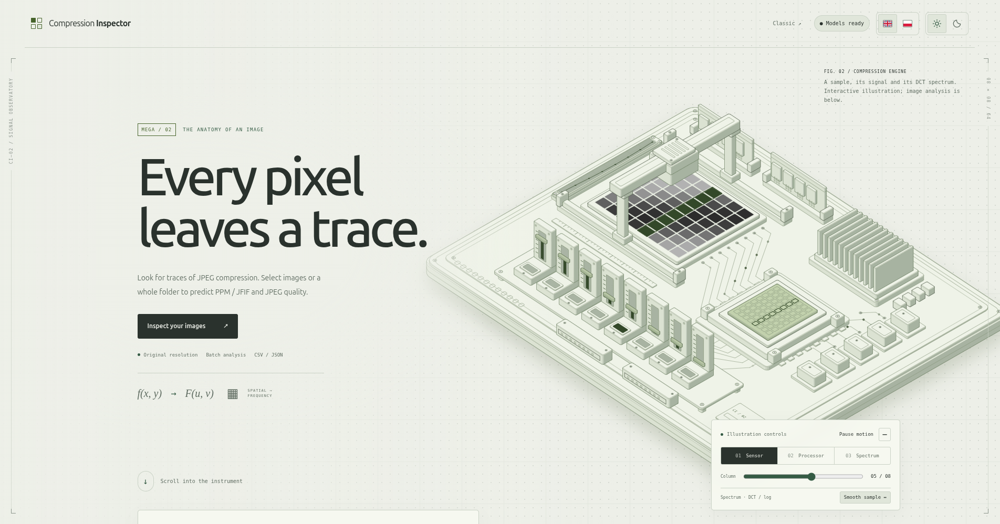

# JPEG Compression Traces in Facial Biometrics

This is the research repository accompanying the 2026 manuscript:

> Maciej Sokolowski and Wojciech Wodo, *Estimating the compression ratio of
> biometric facial images and analyzing its usage for detecting deepfake
> manipulation*.

**Try the web application:** [Compression Inspector](#compression-inspector-web-application)
provides a Docker-based interface for analyzing individual images or entire
folders using pretrained compression models.

Both authors are affiliated with Wroclaw University of Science and Technology.
Wojciech Wodo's ORCID is
[`0000-0002-0237-2882`](https://orcid.org/0000-0002-0237-2882). The supplied
manuscript does not yet provide final publication, repository, or DOI metadata;
replace this pre-publication citation after acceptance or archival release.

The study evaluates whether compact, interpretable image descriptors can:

1. distinguish evidence of JPEG-compatible processing from the historically
   collected uncompressed PPM reference data; and
2. estimate the nominal JPEG encoder quality factor used for controlled
   recompressions of facial images.

Despite the wording *compression ratio* in the manuscript title, the regression
target implemented here is the nominal JPEG quality factor on the conventional
0--100 scale, not a file-size or bit-rate ratio.

> **Interpretation boundary:** the models estimate image-processing history.
> They are not trained as controlled real-versus-deepfake classifiers, and JPEG
> evidence alone cannot prove that an image is genuine, manipulated, injected,
> or AI-generated. The output is intended as an auxiliary consistency signal
> alongside trusted acquisition, liveness checks, metadata, sensor evidence,
> and dedicated manipulation detectors.

## Compression Inspector web application

Compression Inspector is a containerized web application for exploring
compression traces with pretrained models. Select individual images or an
entire folder to estimate JPEG quality factors and predict the JFIF or PPM
class associated with each image's processing history.

### Features

- Single-image and batch analysis through a browser.
- Pretrained JFIF/PPM classification and JPEG quality-factor estimation.
- Per-image predictions and an overlaid histogram showing sample counts
  for both predicted classes across quality bins from 10 to 95.
- CSV and JSON result exports.
- English and Polish interfaces, with English as the default.
- Light and dark themes.

All inference runs inside the container. When you run it on your own
computer, images are processed locally without external analysis services.
Uploaded originals are removed after processing.

The application was generated with the assistance of AI.

### Preview




### Run with Docker Compose

Install Docker with the Compose plugin (Docker Desktop includes it). Clone the
repository and enter the application directory:

```bash
git clone https://github.com/Macsok/JPEG-Compression-Traces-in-Facial-Biometrics.git
cd JPEG-Compression-Traces-in-Facial-Biometrics/compression-web
docker compose pull
docker compose up -d --no-build
```

If you already have the repository, run the last two commands from
`compression-web/`. Open [http://localhost:8000](http://localhost:8000).
The previous Classic layout is available at
[http://localhost:8000/?view=classic](http://localhost:8000/?view=classic).

Compose uses **`ghcr.io/macsok/compression-inspector:1.1.1`**, which contains the
current application, its runtime dependencies and pretrained model weights.
No source mounts, separate Python installation, model download or training step
are needed. Only `compose.yaml` is required to run the published image.
The published release targets Linux/amd64.

The initial download requires internet access. Once the image is cached,
`docker compose up -d --no-build` and image analysis work offline.
Run these commands from `compression-web/` to view logs, restart, or stop and
remove the application container:

```bash
docker compose logs -f compression
docker compose restart compression
docker compose down
```

After updating the release tag in `compose.yaml`, run `docker compose pull` and
`docker compose up -d --no-build` to install the new release. For local source
edits, use the optional development overlay described in the application README.

### Source code and model weights

Application source code and container configuration are in
[`compression-web/`](compression-web/).
See the [application README](compression-web/README.md) for implementation
details and local build instructions.

Pretrained weights are included in the distributed container image but are
not committed to this Git repository. The Dockerfile copies the original weights
from a digest-pinned 1.0.0 image during the build and validates them against
`compression-web/app/artifacts.json`. No manual model-file setup is required.

The application provides an inference interface for the trained models.
Its predictions are subject to the interpretation boundary and scientific
limitations described in this README.

## Reported manuscript results

The values below are results reported in the supplied manuscript. They are
historical research claims, not metrics regenerated after the repository
migration described below.

| Experiment | Result reported in the manuscript | Correct interpretation |
| --- | --- | --- |
| JFIF/JPEG-versus-PPM classification | RBF SVM validation accuracy `1.00000`, test accuracy `0.999776`, and test AUROC `1.000`; one error among 4,468 test images | Separation of the evaluated compressed and uncompressed data pipelines, not proof of synthetic origin |
| External compressed-class checks | 62,957/62,957 iFakeFace samples assigned to the compressed class; 10,994/11,000 independent ThisPersonDoesNotExist samples assigned to the compressed class | Transfer to additional JPEG sources; compressed genuine images would produce the same type of evidence |
| JPEG quality-factor regression | Random Forest test MSE `25.8766`, MAE `2.6569` quality units, and R-squared `0.9601` | Approximate similarity to encoder settings represented in training, not exact recovery of an original encoder configuration |
| Repeated JPEG encoding | Same-quality re-encoding preserved the tested quantization tables; varying quality settings generally increased average blockiness | Earlier encoding sequences remain ambiguous |
| ManyCam virtual-camera test | Source and captured, resized pixel arrays were identical in the tested configuration | One configuration preserved the source evidence; this does not generalize to every virtual camera or API |
| Optical screen recapture | The earlier JPEG trace was not recovered from the uncompressed recaptured image | A new optical acquisition can mask or replace the earlier JPEG block grid |

## Reproduction status

The two canonical modeling workflows use three core feature tables:
`results_jfif.csv`, `results_ppm.csv`, and
`results_240k_one_compression_filtered.csv`. Two additional human-face tables
are committed for the supplementary cross-dataset comparison. All five row
counts, sizes, and SHA-256 digests are recorded in
[`data/manifest.json`](data/manifest.json). The canonical runner verifies every
committed table before executing the classification or quality-regression
notebooks.

Raw-feature regeneration is currently blocked: the licensed source-image
datasets, their complete provenance records, and redistribution permissions
are not bundled. A researcher can supply those inputs locally and use the
batch extractor, but a publication-grade regeneration must wait until the
dataset identities, versions, licenses, citations, grouping identifiers, and
checksums have been recorded. See [Data and results inventory](docs/DATA.md).

No trained model weights are committed to this Git repository. The
Compression Inspector container image includes pretrained weights for
inference; the research workflows below train models from the committed
feature tables. The canonical modeling workflows train
models from the feature tables and write each run's weights under
`results/<run-id>/models`. A manual notebook session without a run ID uses
`results/manual/models`. The `results` directory is created only when a
workflow is executed and is ignored by Git. Serialized weights must not be
treated as source data or loaded without checksum verification.

The commands below define the intended workflow. They do **not** claim that a
fresh end-to-end `Run All` of every notebook has passed during the current
repository migration. Record the environment and inspect the executed
notebooks before using regenerated numbers in a paper.

The manuscript's external iFakeFaceDB, DigiFace-1M, UCF Selfie, Human Faces,
and camera/recapture image inputs are not bundled. Therefore, the two canonical
pipelines can reproduce the core modeling procedure from committed feature
tables, while the external and hardware-dependent claims require separately
acquired data and the original acquisition conditions. Two derived tables
labelled as AI and real Human Faces subsets are included, but their complete
source/version/license mapping still requires an author-supplied provenance
record.

## Method overview

The research workflow has four layers:

1. **Feature extraction.** Images are decoded with OpenCV and represented by
   blockiness, DCT-energy, recompression-quality, and PSNR features.
2. **Format classification.** Models compare the JFIF and PPM processed tables.
   The historical candidates include random forest, gradient boosting, RBF
   SVM, logistic regression, and k-nearest neighbors.
3. **Quality regression.** Linear regression, random forest, gradient boosting,
   and RBF SVR estimate the quality label encoded in controlled JPEG filenames.
4. **Supplementary experiments.** Repeated JPEG compression, quantization and
   Huffman-table inspection, cross-dataset comparisons, and physical-camera
   capture probe the behavior and limitations of the features.

Each decoded image is represented by eight alignment-specific blockiness
coefficients, their maximum/mean/standard deviation, mean and standard
deviation of blockwise DCT AC energy, and auxiliary recompression quality/PSNR
descriptors. The main protocol did not apply dataset-level image normalization,
rescaling, or additional preprocessing before feature extraction. The shared
implementation is
[`src/jpeg_compression_detection/features.py`](src/jpeg_compression_detection/features.py).
The manuscript's tree-based analysis identifies `blockiness_4` and
`blockiness_std` as especially informative for the primary classification
task, while also warning that feature rankings can depend on dataset and image
resolution.

The main study used approximately 11,000 uncompressed colorFERET PPM images at
512 x 768 pixels and approximately 11,000 synthetic
ThisPersonDoesNotExist JPEG/JFIF images at 1024 x 1024 pixels. For quality
regression, colorFERET sources were encoded at 21 nominal quality factors. The
committed filtered table contains 238,098 rows at qualities 10, 20, 30, 40, 50,
60, 70, 75, 78, 80, 82, 84, 86, 88, 89, 90, 91, 92, 93, 94, and 95. The exact
current table counts and hashes are authoritative in
[`data/manifest.json`](data/manifest.json); the manuscript's image counts are
approximate descriptions of the original experiment.

### Active core protocol

These implementation details come from the active notebooks and make the
currently reproducible procedure more precise than the manuscript narrative:

| Workflow | Rows used | Deterministic split | Features and preprocessing | Model selection |
| --- | ---: | --- | --- | --- |
| JFIF/JPEG-versus-PPM classification | 22,338: 11,000 JFIF and 11,338 PPM | 14,296 train / 3,574 validation / 4,468 test (`64%/16%/20%`), stratified shuffled splits with seed 42 | 15 numerical descriptors; `StandardScaler` fitted only on training data and applied to every candidate | Highest validation accuracy |
| JPEG quality-factor regression | 238,098 input rows; 237,692 after dropping 406 rows with missing PSNR | 142,614 train / 47,539 validation / 47,539 test (`60%/20%/20%`), shuffled row-wise splits with seed 42 | 14 numerical descriptors; `estimated_quality` is excluded and no scaler is used | Highest validation R-squared |

The regression split deliberately preserves the recovered historical protocol,
but it is not source-disjoint: JPEG variants derived from the same photograph
can occur in different partitions. The manuscript's reported MAE and R-squared
must therefore be read as results of that potentially content-leaking protocol.
A confirmatory publication experiment should group by source image or identity
and report its results separately rather than silently replacing the historical
benchmark.

## Paper-to-repository map

| Manuscript component | Repository entry point | Reproduction level |
| --- | --- | --- |
| Feature definition and extraction | [`features.py`](src/jpeg_compression_detection/features.py), [`extract_features.py`](scripts/extract_features.py), and `notebooks/01_feature_exploration/` | Code is available; complete raw-image regeneration is blocked by unbundled licensed inputs |
| JPEG-compatible processing classifier | `notebooks/03_classification/01_train_jfif_vs_ppm_classifier.ipynb` and `02_evaluate_jfif_vs_ppm_classifier.ipynb` | Canonical automated pipeline from committed feature tables |
| Single-image classification and quality inspection | `notebooks/03_classification/03_test_quality_and_format_models.ipynb` and `notebooks/04_quality_regression/03_test_quality_regressors.ipynb` | Requires freshly trained models and a locally supplied image |
| Nominal quality-factor regression | `notebooks/04_quality_regression/01_train_quality_regressors.ipynb` and `02_evaluate_selected_quality_regressor.ipynb` | Canonical automated pipeline from the committed 238,098-row table |
| Cross-dataset quality comparison | `notebooks/04_quality_regression/04_compare_quality_across_datasets.ipynb` | Partly supported by two committed derived tables; the remaining named external inputs are absent |
| Repeated compression | `notebooks/02_multiple_compression/` | Manual supplementary workflow requiring a locally supplied source-image directory |
| Quantization-table inspection | `notebooks/01_feature_exploration/03_jpeg_quantization_tables.ipynb` | Manual supplementary workflow |
| Camera and recapture utilities related to the supplementary tests | `notebooks/05_camera/01_camera_experiments.ipynb` and [`camera_capture_demo.py`](scripts/camera_capture_demo.py) | Partial manual support only: the active code does not configure ManyCam or automatically reproduce the manuscript's resized-source-versus-virtual-frame comparison or exact screen-recapture protocol |

## Repository layout

```text
.
├── README.md
├── pyproject.toml
├── requirements.txt
├── compression-web/        # web application and Docker configuration
├── environment/
│   ├── environment.yml
│   └── requirements-lock.txt
├── docs/
│   ├── DATA.md
│   ├── ENVIRONMENT.md
│   ├── MIGRATION.md
│   ├── PUBLICATION_CHECKLIST.md
│   └── figures/             # two preserved reference plots
├── src/jpeg_compression_detection/
│   ├── __init__.py
│   ├── features.py
│   └── paths.py
├── scripts/
│   ├── camera_capture_demo.py
│   ├── extract_features.py
│   ├── run_reproduction.py
│   └── verify_data.py
├── notebooks/
│   ├── 01_feature_exploration/
│   │   ├── 01_general_feature_exploration.ipynb
│   │   ├── 02_single_blockiness_exploration.ipynb
│   │   └── 03_jpeg_quantization_tables.ipynb
│   ├── 02_multiple_compression/
│   │   ├── 01_generate_and_analyze_multiple_compression.ipynb
│   │   └── 02_visualize_multiple_compression.ipynb
│   ├── 03_classification/
│   │   ├── 01_train_jfif_vs_ppm_classifier.ipynb
│   │   ├── 02_evaluate_jfif_vs_ppm_classifier.ipynb
│   │   └── 03_test_quality_and_format_models.ipynb
│   ├── 04_quality_regression/
│   │   ├── 01_train_quality_regressors.ipynb
│   │   ├── 02_evaluate_selected_quality_regressor.ipynb
│   │   ├── 03_test_quality_regressors.ipynb
│   │   └── 04_compare_quality_across_datasets.ipynb
│   └── 05_camera/
│       └── 01_camera_experiments.ipynb
├── data/
│   ├── manifest.json
│   └── results_*.csv        # five verified feature tables
├── tests/
└── archive/polish_originals/
```

### Flat data and on-demand results

The repository contains no empty placeholder directories and no `.gitkeep`
files. The five committed CSV files and their manifest live directly in
`data/`. Licensed source images are not committed and may be supplied from any
directory selected by the researcher. Any optional subdirectory created below
`data/` is ignored by Git, and notebook examples skip cleanly when their locally
configured images are absent.

Generated models, plots, executed notebooks, camera captures, and environment
records are written under `results/<run-id>/`. Manual notebook sessions use
`results/manual/`. The `results` directory is ignored by Git and does not exist
in a clean checkout; the code creates only the subdirectories required by an
actual run. Treat `results/manual/` as disposable scratch output; set a unique
`JPEG_RESEARCH_RUN_ID` for anything that must be retained or cited.

The `archive/polish_originals` directory is an immutable historical snapshot,
not an executable part of the active workflow. Its purpose is explained in
[`archive/polish_originals/README.md`](archive/polish_originals/README.md).
Licensing, citation, and dataset-provenance fields that require author input
are listed in
[`docs/PUBLICATION_CHECKLIST.md`](docs/PUBLICATION_CHECKLIST.md).

## Research environment setup

The recovered reference interpreter is Python 3.10.11. Exact direct package
versions and platform notes are documented in
[`docs/ENVIRONMENT.md`](docs/ENVIRONMENT.md).

### Linux or macOS

```bash
python3.10 -m venv .venv
source .venv/bin/activate
python --version
python -m pip install --upgrade pip
python -m pip install -r requirements.txt
```

### Windows PowerShell

```powershell
py -3.10 -m venv .venv
.\.venv\Scripts\Activate.ps1
python --version
python -m pip install --upgrade pip
python -m pip install -r requirements.txt
```

Confirm that `python --version` reports 3.10.11. The requirements entry point
installs the package in editable mode with the research and test extras. The
file named `environment/requirements-lock.txt` records the pinned direct
environment entry point; it is not a complete cross-platform transitive lock.

Verify the committed research inputs and run the automated tests:

```bash
python scripts/verify_data.py
python -m pytest
```

`verify_data.py` checks the five CSV tables against
[`data/manifest.json`](data/manifest.json), including hashes, sizes, and row
counts.

## Canonical modeling workflows

Run each pipeline from the repository root. By default, the runner verifies
all committed inputs and gives each notebook cell a six-hour timeout
(21,600 seconds).

```bash
python scripts/run_reproduction.py --pipeline classification
python scripts/run_reproduction.py --pipeline quality-regression
```

Supply a stable identifier when the run belongs to a paper, release, or
comparison:

```bash
python scripts/run_reproduction.py --pipeline all --run-id paper-v1
```

The intended classification sequence is:

1. `notebooks/03_classification/01_train_jfif_vs_ppm_classifier.ipynb`
2. `notebooks/03_classification/02_evaluate_jfif_vs_ppm_classifier.ipynb`

The intended quality-regression sequence is:

1. `notebooks/04_quality_regression/01_train_quality_regressors.ipynb`
2. `notebooks/04_quality_regression/02_evaluate_selected_quality_regressor.ipynb`

Every invocation creates a new `results/<run-id>/` directory containing
`run.json`, trained models, generated figures, executed notebook copies under
`executed_notebooks/<pipeline>/`, installed-package and source-code manifests,
and `result-manifest.json` with the size and SHA-256 digest of every generated
file. Source notebooks are not overwritten. Without `--run-id`, the
runner uses a UTC timestamp. It refuses to reuse an existing run directory.
Run `--pipeline all` only after both individual workflows have been checked in
the active environment. Do not use `--skip-input-verification` for a research
result.

If platform or hardware records are added manually after notebook execution,
refresh the final checksums once and then treat the run directory as
immutable:

```bash
python scripts/run_reproduction.py --finalize-only --run-id paper-v1
```

The quality workflow intentionally retains the historical RBF `SVR` candidate
and fits it to roughly 143,000 training rows. LibSVM training can exceed six
hours or available memory depending on the machine; no complete fresh
benchmark was performed during this migration. Increase `--timeout` or use
`--timeout -1` only on a monitored research machine. Reducing the sample or
replacing SVR defines a different, separately versioned experiment. Each
candidate model and its metrics are checkpointed immediately after completion,
so an SVR timeout leaves a visibly failed run with recoverable partial
results rather than discarding earlier fitted candidates.

## Manual Jupyter workflow

Register the environment as a kernel, start the classic Notebook server from
the repository root, and select that kernel in every notebook:

```bash
python -m ipykernel install --user --name jpeg-compression-research --display-name "JPEG compression research (Python 3.10.11)"
python -m notebook
```

JupyterLab was not present in the recovered reference environment. Exploratory
and supplementary notebooks can be run manually in the numerical order shown
in the repository tree. Training notebooks must precede notebooks that load
their model files. Optional cross-dataset and camera cells should report a
missing input and continue rather than being interpreted as completed tests.

To make a supplementary notebook load models from an existing canonical run
that has not yet been finalized, start Jupyter with the same run identifier:

```powershell
$env:JPEG_RESEARCH_RUN_ID = "paper-v1"
python -m notebook
```

```bash
JPEG_RESEARCH_RUN_ID=paper-v1 python -m notebook
```

Additional figures will then be written inside that run. Add all manual
environment records and run `--finalize-only --run-id paper-v1` afterward.
Do not extend an already published immutable run; create a new run identifier
instead.

## Batch feature extraction

Pass the licensed source-image directory explicitly. Write exploratory output
under the on-demand manual results directory:

```bash
python scripts/extract_features.py \
  --input <licensed-image-directory> \
  --output results/manual/features.csv
```

The extractor accepts JPEG/JFIF, PNG, BMP, TIFF, WebP, and PPM files in one
directory, processes them in sorted order, and creates the output directory.
It also writes `<output-stem>.errors.csv` and exits with a nonzero status if
any image fails. Use `--allow-errors` only for explicitly incomplete
exploratory tables. The feature and error outputs must be different files.
The extractor overwrites the selected CSV, so never point it at a committed
table without preserving the old file and checksum. A regenerated
table needs an updated provenance record and manifest entry before it can be
used in a reproduction claim.

## Camera demonstration

The camera script requires a physical camera, an interactive GUI session, and
an explicitly supplied source image:

```bash
python scripts/camera_capture_demo.py \
  --source <path-to-source-image> \
  --camera-index 0 \
  --extension .png
```

Captures are written to `results/manual/camera` by default. If no camera is
available, the command fails unless `--allow-fallback` is supplied. That
option writes `software_fallback.<ext>` with a JSON sidecar and is only a
software smoke test. A physical capture is labeled
`physical_camera_capture.<ext>` and also gets a sidecar. Pressing `q` cancels
without writing a file. Record camera, driver, display, exposure, geometry,
and lighting metadata as described in the environment documentation.

## Inputs and outputs

| Category | Canonical location | Status |
| --- | --- | --- |
| Verified feature inputs | `data/results_*.csv` | Five tables bundled and checksummed |
| Licensed source images | Researcher-selected path | Not bundled; license and provenance record required |
| Preserved reference figures | `docs/figures/` | Two figures retained with the documentation |
| Canonical run results | `results/<run-id>/` | Models, figures, executed notebooks, environment/source records, `run.json`, and checksums |
| Manual-session results | `results/manual/` | Models, figures, generated image variants, and camera captures created only when needed |

The five feature tables contain 238,098 quality-regression rows, 11,000 JFIF
rows, 11,338 PPM rows, 4,630 AI-generated-face evaluation rows, and 5,000
real-face evaluation rows. Exact schemas, missing-value counts, digests, and
provenance requirements are in [`docs/DATA.md`](docs/DATA.md).

## Reproducibility and scientific caveats

- Use Python 3.10.11 and the pinned direct dependencies. Capture a complete
  `pip freeze --all`, OpenCV build information, JPEG codec versions, operating
  system, CPU, and hardware metadata for every published run.
- Use seed 42 for Python/NumPy sampling, pandas sampling, data splitting, and
  stochastic estimators. Historical core splits use `random_state=42`, but not
  every exploratory plot was originally seeded.
- The full historical quality workflow includes an RBF SVR on roughly 143,000
  training rows. Its wall time and memory demand are hardware-dependent, and
  the migrated end-to-end run has not yet been benchmarked.
- The active quality-regression workflow preserves the historical row-wise
  split. This can place compression variants of one source in different
  partitions and inflate metrics. A confirmatory experiment must group by
  source image and preferably by identity.
- The active quality-regression workflow reuses its original held-out
  validation and test partitions when reloading models. The historical
  snapshot resplit a sample from the full table at that stage and could mix
  training rows into apparent holdout metrics; do not compare those secondary
  historical plots as if they were equivalent.
- The JFIF and PPM tables originate from different image collections. Very
  high accuracy can measure dataset identity, content, dimensions, or
  acquisition pipeline rather than compression alone. A confirmatory design
  should use paired encodings and group-held-out or dataset-held-out tests.
- Cross-dataset overlay/envelope helpers default to min-max normalization of
  each dataset independently to `[0, 100]`. Those plots compare distribution
  shapes, not raw nominal-quality predictions. Use
  `normalize_each_dataset=False` and record the choice when comparing raw model
  outputs.
- The descriptors are global and mainly grayscale. Texture, illumination,
  background, and image resolution can affect them, and they do not localize
  which facial regions produced the signal.
- Robustness has not been tested systematically for resizing, cropping, blur,
  screenshots, social-media processing, or format/color conversion. The
  available virtual-camera and recapture observations cover only limited
  configurations.
- JPEG outputs can vary across OpenCV, Pillow, libjpeg/libjpeg-turbo, platform,
  and codec-build versions. Exact Python package pins do not guarantee
  byte-identical recompressions across systems.
- The recompression-based quality value is a heuristic, not recovery of the
  original encoder settings. Repeated compression and high-quality JPEGs can
  be ambiguous.
- The feature code intentionally preserves the historical calculations used
  to create the committed tables. Treat any numerical correction as a new
  scientific-method version and regenerate data, models, figures, and
  checksums under new versioned result names.
- `n_jobs=-1`, BLAS implementations, CPU instruction sets, and thread
  scheduling can introduce small numerical differences. Record hardware and
  thread settings when strict comparisons are required.
- Camera results are protocol-dependent and cannot be reproduced as identical
  pixels. They require documented hardware and acquisition conditions.
- Operational use would additionally require calibrated uncertainty, an
  inconclusive outcome for unfamiliar samples, realistic class prevalence,
  threshold analysis, and measurement of downstream face-recognition impact;
  these are outside the current implementation.

This repository should therefore be read as a reproducible implementation of
the documented experiments, not as evidence that the current models
generalize to every image source or forensic setting.

## Historical archive

The original Polish README, scripts, notebooks, outputs, and workstation paths
are preserved under [`archive/polish_originals`](archive/polish_originals/).
They exist to support audit and comparison. Do not execute or edit the archive;
use the English active package, scripts, and notebooks instead.
